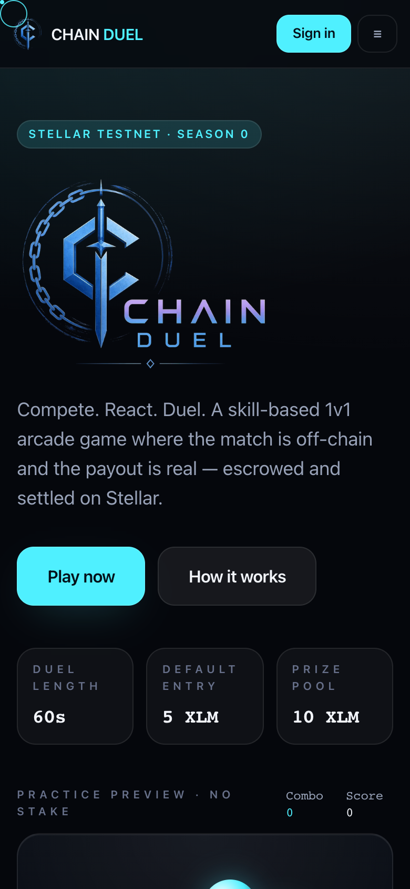
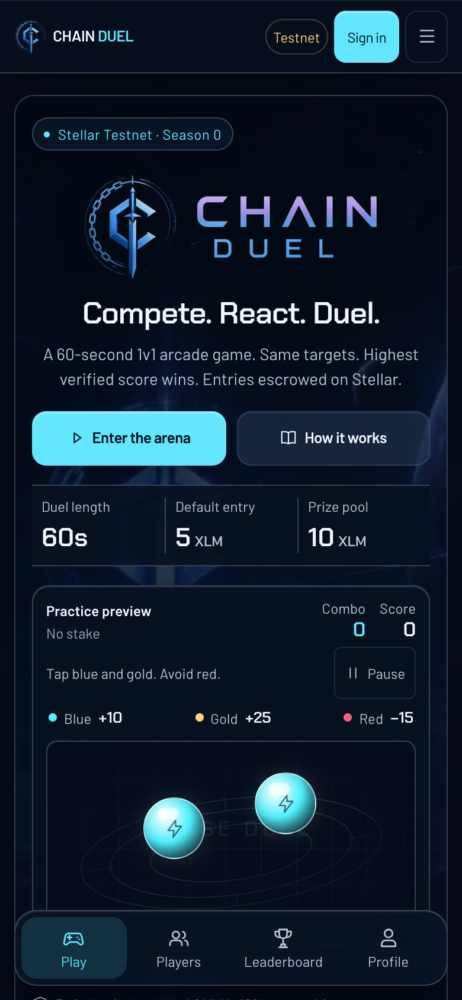
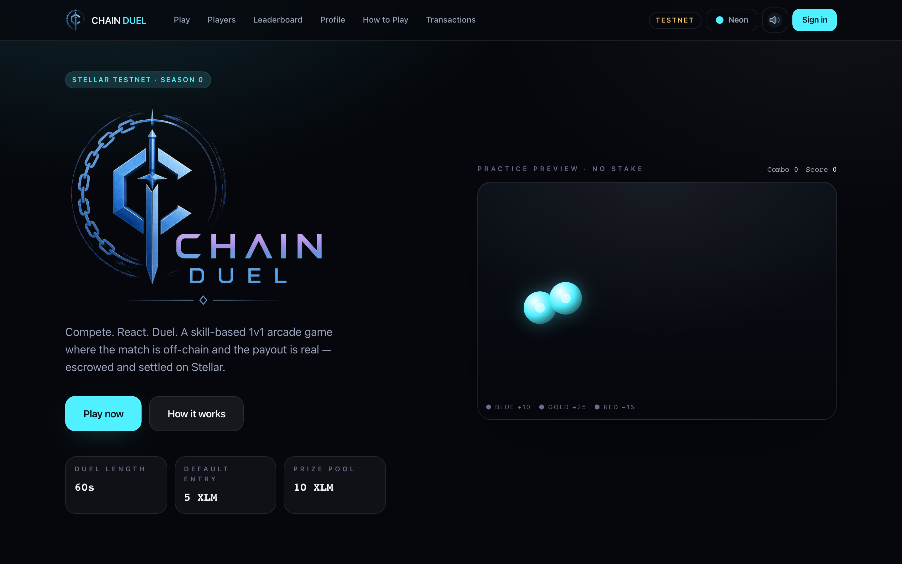
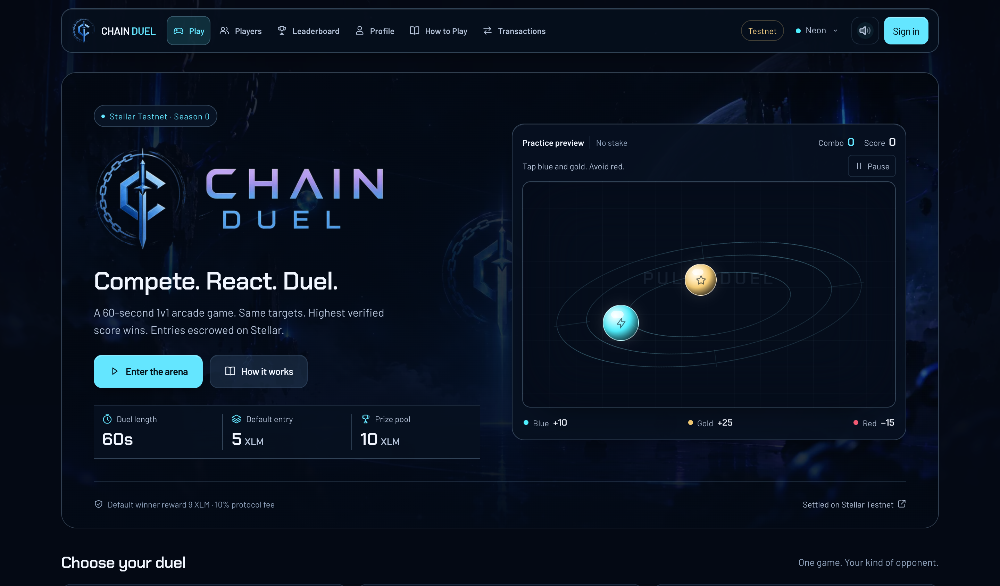

# Review captures

These captures compare the starting committed website with the completed local
production build. Phone captures use 390×844 CSS pixels. The desktop image is
1440 CSS pixels wide. No mock data was injected into production components.

| Before | After |
| --- | --- |
|  |  |
|  |  |

The actual no-stake multiplayer run is documented by `browser-report.json`,
`arena-mobile.png` and `result-mobile.png`. The final score display was asserted
against the stored server outcome for both players. `profile-mobile.png` shows
the corrected long-name layout. `homepage-scan.json` records no failures; warnings
are explained in the critique. Platform evidence is in `platform-matrix.md`.

Extensive seven-size route/gameplay captures remain under
`/private/tmp/chain-duel-audit/`. See the parent audit for the preservation review
and verification limits.

`focus-browser-report.json` adds the target-overlap keyboard regression and a
second complete production-build gameplay/account run. `focus-scan.json` verifies
the corrected keyboard walk has no failures. The matrix summary includes this
last focus-layer correction.
