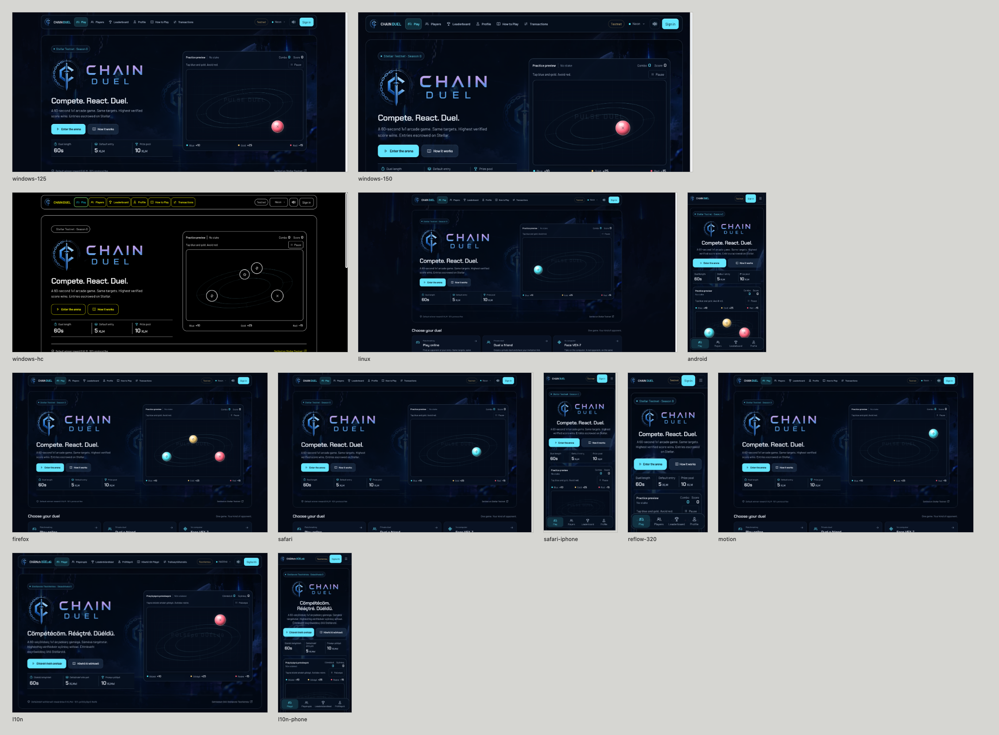

# Platform matrix

All twelve checks passed with no failures. Host: macOS; Windows/Linux font
metrics use compatible stand-ins, so this is browser/emulation evidence.

| Check | Viewport / scale | Engine |
| --- | --- | --- |
| Windows 125% | 1536×730 / 1.25 | Chrome |
| Windows 150% | 1280×610 / 1.5 | Chrome |
| Windows High Contrast | 1536×730 / 1.25 | Chrome forced colors |
| Linux | 1920×960 / 1 | Chrome |
| Android | 412×840 / 2.625 | Chrome |
| Firefox | 1440×900 / 1 | Playwright Firefox |
| Safari | 1440×900 / 2 | Playwright WebKit |
| iPhone | 390×844 / 3 | Playwright WebKit |
| Narrow reflow | 320×640 / 2 | Chrome |
| Reduced motion | 1440×900 / 1 | Chrome |
| Expanded text | 1280×800 / 1 | Chrome |
| Expanded text, phone | 390×844 / 2 | Chrome |

Individual captures: `/private/tmp/chain-duel-audit/matrix-shipping/`.
