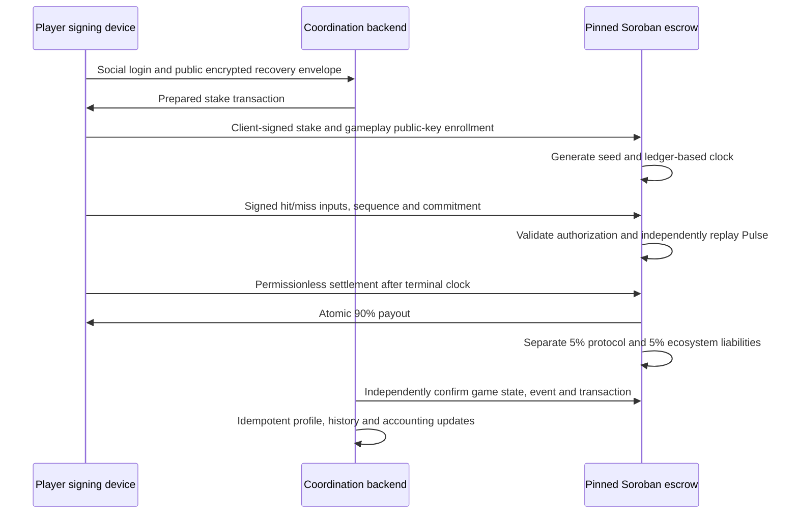

# Stellar independent verification: implementation review

Review date: 2026-11-25. Branch: `feat/stellar-independent-verification`.

**Verdict: NOT READY: SECURITY OR FUNCTIONALITY ISSUES REMAIN.**
The controlled Testnet implementation and automated campaign pass. Production
release still needs the provider/OAuth ceremonies, operational checks and
explicit owner approval described below. No Mainnet deployment or irreversible
player-authority migration has occurred.

## Architecture and original attack

The original escrow accepted administrator-supplied scores and a winner. An
authorized backend could fabricate a result and release funds even when those
numbers were internally consistent. The preserved witness is
[legacy-score-audit.rs.txt](stellar-verified-deployments/legacy-score-audit.rs.txt).

The replacement Soroban escrow independently reconstructs Pulse Duel's target
stream and replays each participant's authorized hit/miss inputs. It derives
scores, combos, VEX-7, timing, terminal state and the score/combo/seat-1 winner.
`settle_game` accepts only a game ID; a score, winner, bot transcript or fee
argument cannot authorize a payout.

`create_game`/`join_game` bind the stake and participant gameplay key.
`start_game` establishes the immutable seed/countdown/end/deadline.
`submit_inputs` authenticates domain-bound compact transcripts and validates
every transition. `rotate_input_key` requires the participant's authority and
preserves accepted inputs. `settle_game` enforces completion and calculates the
result. Cancellation/expiry return eligible deposits; active missing inputs
score zero at the deadline and cannot force a refund or block completion.

The existing 60-second simultaneous game, 3.2-second countdown, target RNG,
reaction floor, scoring, combo tiers, VEX-7 and seat tie-break are unchanged.
A 10-second confirmation buffer precedes the countdown. Input deadline remains
countdown base +80 seconds. Software IEEE-754 reproduces JavaScript arithmetic;
192 unchanged engine fixtures establish schedule/human/computer parity.

## Testnet deployment and designated authority

| Item | Verified value |
| --- | --- |
| Existing deployer, only external administrator, treasury and both fee beneficiaries | `GCQKVXWIQHVGUOUHZR2O6YBWBNNPKIYH5AWQHXHF3EYRHM73WIWVSK7K` |
| Independently verified Testnet escrow | `CCBSSZQ34DSSLHSLUSK6DHGPM6RFXJBHZY6ZELHEE2UJJFDQ2SHZYNT5` |
| Optimized WASM SHA-256 | `9459f853992e8d59d9c2e74f404f6556205f515d09681c711f7200827b64c59f` |
| Optimized WASM size | 39,385 bytes |
| Official Circle Testnet USDC | `CBIELTK6YBZJU5UP2WWQEUCYKLPU6AUNZ2BQ4WWFEIE3USCIHMXQDAMA` |
| Upload transaction | `4abe46b7f1be81aa01cbd7dd24f48a6077e8c382549ed7cd3dbdb91be58b2ff6` |
| Atomic deployment/initialization transaction | `49fd33e7ea1c81905fe9b0d8d5f1e3df0628f482992862745e098b386bab2313` |
| Deployment XLM spent, from live receipts | 41.5399424 Testnet XLM |

The checksum-valid existing address ends in `VSK7K`. The shorter string ending
`VSK7` is invalid and was never substituted. No replacement deployment wallet
or administrator was created.

| Authority | Actual permissions |
| --- | --- |
| Designated wallet above | Deploy/initialize; pause new games; toggle computer mode; bounded limits; collect its earned protocol/ecosystem fees and free computer liquidity |
| Ordinary participant | Authorize its own stake and gameplay key, submit authorized inputs, recover/rotate its own input key, cancel its eligible unjoined game |
| Any caller | Start a funded eligible game, settle according to verified rules, claim eligible expiry refunds to the original depositors |
| Escrow contract | Hold stakes/liabilities; independently calculate results; atomically pay the winner; maintain separate fee/liquidity buckets |
| Backend administrator signer | Sponsor/relay permitted calls; cannot forge player inputs, override winners, redirect fees, change fixed 90/5/5 rates or withdraw player liabilities |
| Unrelated external account | No administrative or other-player signing/withdrawal authority |

No upgrade, arbitrary token extraction, owner winner override or unrestricted
player-fund recovery entry point exists. The administrator's controls cannot
consume active escrow, another allocation or reserved bot liquidity.

## Financial verification

A 100-USDC pot pays 90 USDC to the verified winner and accrues 5 protocol plus
5 ecosystem USDC, both owned by the designated administrator. These are game
fees; Stellar resource/transaction fees are separate XLM expenditure.

| Controlled Testnet check | Evidence |
| --- | --- |
| 100-USDC PvP pot, verified 90-USDC winner payout | `9244893b7ab7b9ee6e557c193312c0e83ec3ce9180d458d1be148142a0aa246e` |
| Independent VEX-7 reconstruction and settlement | `15397470842e9774fef0ef32da265b56f7a184a25984df91484a3f4f6be2c86a` |
| Missing inputs: verified inputs count, absent seat scores zero | `0b28f138814d0bc4d9bd1171a9ce90fca04d5f2c79be721f20d326a620fdd9e9` |
| Existing seat-1 tie-break | `5844f10ae90e0c29d30b087dcd547882121734512a56c0ad61c58150e6be7d28` |
| Eligible depositor refund | `1a73b0ffe76c80d49d50d72741c5ce9f81f70318a5f2fe39864eb1dabf439d89` |
| Forged input rejected in an included transaction | `deb3ad4a24d9a3865c209fafe600f257eb8b61712b39cd69947308f615161926` |
| Original fabricated-result ABI attack rejected on-chain | `15663b14c2fb1abc10469fd3e22e7f17c97647620460e82d796b376d9bdcd142` |
| Unauthorized fee withdrawal rejected on-chain | `884ce3f1ba01ceff02000fc77ac0437ab99c9f4e72ea528529eb903b2caa3647` |
| 12.5 protocol USDC received by designated wallet | `1f221dc38ee9a07119df89c53f6925e7e420252bdbdc6c86013e55f9394b146f` |
| 12.5 ecosystem USDC received by designated wallet | `209782c2452da41aa46947c57f056328ed86895172890ff717ba0638d73c73dd` |

Full expected/actual outcomes, failed transactions versus simulation rejections,
resource fees, balances and receipt details are preserved in
[testnet-evidence.json](stellar-verified-deployments/testnet-evidence.json).
The zero active-escrow assertion there covers that completed financial campaign;
subsequent browser-game receipts are recorded separately.

The real browser campaign used new browser-held player keys and official Testnet
USDC. Both players signed their own trustlines/stakes. The full invitation, join,
60-second gameplay, legal hit capture and input submission ran in Chrome. The
contract recorded 16 verified hits and a 190-to-zero result. A 50-USDC pot paid
45 USDC, accrued 2.5 in each administrator allocation and left the players with
95 and 50 USDC. Settlement: `4b99ad13bfdd58cc6346d820103eaf972955c8d03f2c7f482d2e84eb15717f83`.

The browser run exposed and fixed an SDK transport timeout defect and an event
format change: Protocol 30 omits `inSuccessfulContractCall`. The application now
requires a confirmed successful transaction at the exact expected ledger, while
rejecting explicit failed events, failed/missing transactions, wrong ledgers and
mismatched games/participants. It recovered this existing settlement without a
second stake or payout. The expired prior browser invitation was refunded before
retrying. Browser funding and game recovery are now resumable and idempotent.

## Player-controlled signing and migration

New Google/X social-login wallets are created in the browser. The signing key
is nonextractable in IndexedDB. The backend stores public signer metadata and
an HKDF-SHA256/AES-256-GCM encrypted backup, wrapped by a player-held 192-bit
recovery code. Recovery runs locally, verifies the public identity and preserves
the address. Real-browser wrong-code rejection and recovery after local key loss
pass. Plaintext private/recovery material is excluded from API payloads.

Existing managed addresses require a separately approved migration: independently
confirm the player's device/recovery keys and per-wallet manifest; verify backup
recovery, reserves and outstanding liabilities; atomically add the approved
signers, set thresholds and revoke the old master weight; independently verify
that the former backend-held key no longer authorizes transactions. Social login
or backend-created key-possession proofs alone cannot approve that ceremony.
No application endpoint performs the irreversible transition. Pending managed
wallets cannot enter verified stakes. The designated admin is excluded.

Client mode blocks backend player-key loading, decryption, generation and signing.
Wallet transfers, trustlines, stakes and Stellar bridge authorization use client
signed envelopes. Original production credentials and player authority remain
unchanged until separately approved cutover; historical backend copies cannot
be revoked by an application flag.

The read-only production association audit reproduces the original fingerprints
and record counts: 99 users/profiles/wallets, 91 encrypted key records and 66 games.
The isolated Testnet Preview uses a separate schema, independent sessions and no
valid legacy player decryption credential. Mainnet gaming and Arc/bridge financial
operations are disabled in this branch's Preview; production is unchanged.

## Performance and completed checks

| Verification | Result |
| --- | --- |
| Application tests | 350 passed; 17 opt-in checks skipped |
| Live isolated PostgreSQL Stellar/Arc migration tests | 2 passed separately; fixtures rolled back |
| Independent escrow tests | 32 passed |
| Replay tests | 5 passed, including 192 reference games |
| Legacy escrow regression tests | 23 passed |
| Compiled escrow resource probe | Passed against the exact pinned WASM |
| Unchanged Arc contract tests | 16 passed |
| Mainnet preparation/authorization regression checks | 9 passed |
| Typecheck, lint, production build | Passed |
| Browser signing/recovery/game/receipt/history checks | Passed, see browser evidence |
| Production wallet/key association fingerprints | Match saved baseline |

The 17 opt-in skips are not counted as verification; live PostgreSQL checks were
run separately. Provider/OAuth ceremonies and operational checks below remain
unverified.

The 4,000-event escrow input used 18,702,853 CPU instructions and 1,642,161 memory
bytes; VEX-7 settlement used 12,128,968 instructions. The SDK probe budget is
400 million instructions and 40 MiB; live transaction acceptance additionally
proves the actual Testnet path. A 300-second/4,000-event stress probe used
63,120,341 instructions, without changing production duration. The maximum
transcript is 24,000 bytes before its envelope. SDK fee modeling is not a live
Mainnet fee quote. Actual Testnet deployment spent 41.5399424 XLM, exceeding the
earlier provisional constructor allowance.

Evidence: [resource measurements](stellar-verified-deployments/resource-evidence.json),
[browser campaign](stellar-verified-deployments/browser-evidence.json),
[production association audit](stellar-verified-deployments/production-associations-after.json),
[security report](stellar-verified-security-report.md),
[signing/migration plan](stellar-player-controlled-signing.md).

## Remaining release gates

1. Complete interactive signing/recovery with every supported Freighter, xBull,
   LOBSTR, Albedo and Rabet provider, plus live Google/X OAuth ceremonies.
2. Review each legacy wallet's independently confirmed signer manifest and restore
   test before approving its irreversible authority change. Then revoke historical
   masters and remove legacy application decryption capability/data access.
3. Prepare fresh Mainnet deployment/constructor simulations, reserves, XLM funding
   and a reviewed expenditure cap. The historical signed-score plan/40-XLM cap is
   obsolete; archived JSON is not an authorization or current quote.
4. Validate production TTL/restoration, monitoring, transaction fee sponsorship,
   deadlines under congestion, funding and recovery operations.
5. Obtain explicit owner approval for this Mainnet deployment and each irreversible
   player-authority migration. Execute controlled Mainnet tests only within that
   later authorization, then cross-check configuration, chain and application.

A signature proves authorization of legal inputs, not a physical human tap.
Players can automate legal play. The device and signing origin must be trusted;
malicious same-origin code can request signatures even from nonextractable keys.
RPC outages, ledger congestion and insufficient XLM can still cause missed input
deadlines. These boundaries are not hidden by the successful Testnet campaign.

The final result and phone wallet screenshots are retained as public Testnet evidence:
[result](stellar-verified-deployments/browser/winner-result.png) and
[phone wallet](stellar-verified-deployments/browser/wallet-390.png).

## Changed files

Every changed/new path and its purpose is listed in
[stellar-independent-verification-files.json](stellar-independent-verification-files.json).
The separate Arc source/contracts were not modified. The GitHub branch and guarded
Vercel Preview expose this candidate for review; they do not authorize production
cutover. Deployment metadata is recorded after publication in
`stellar-verified-deployments/preview-release.json`.
